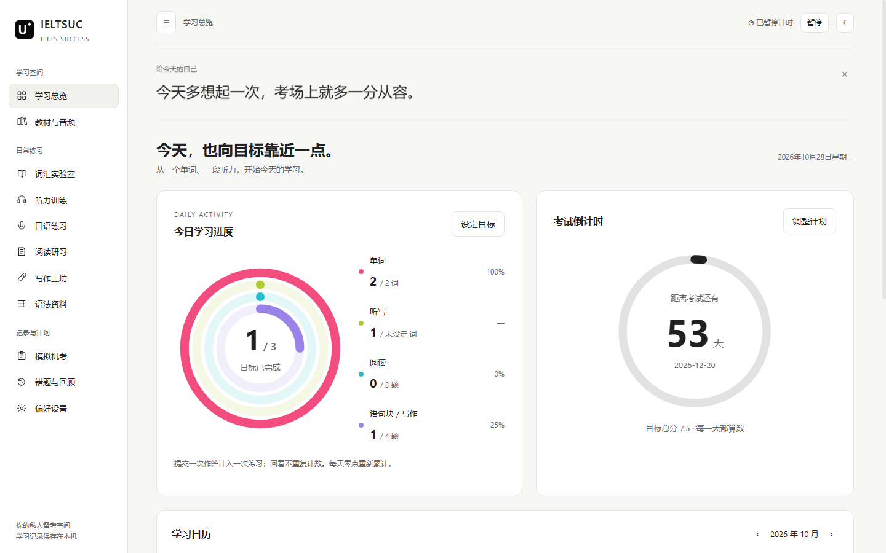
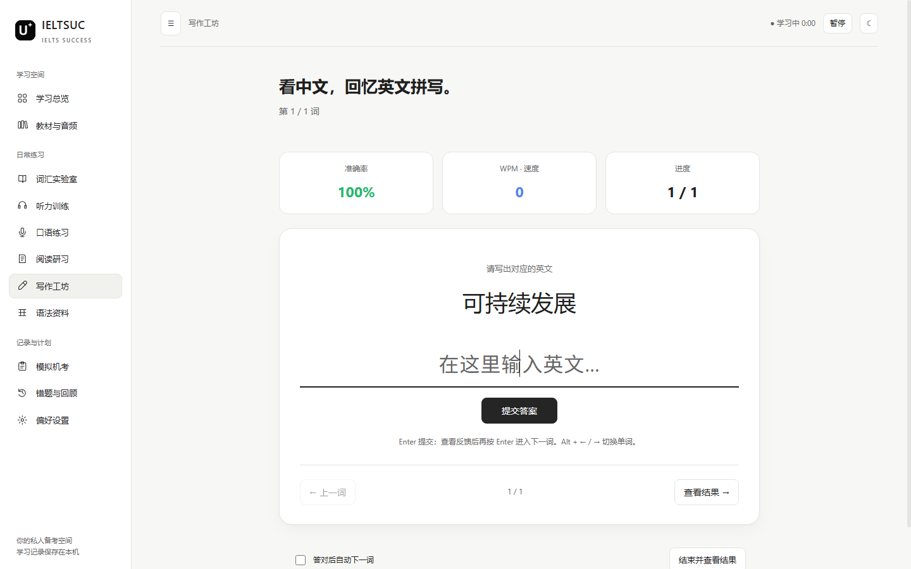
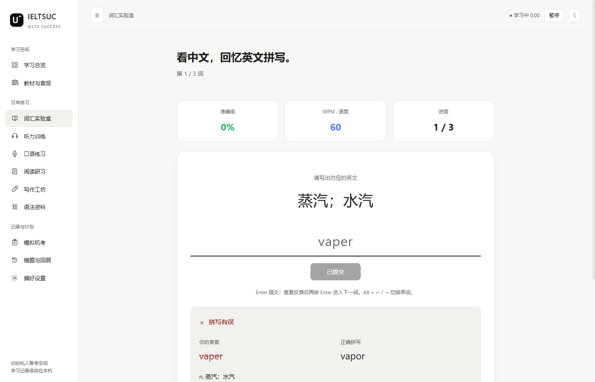
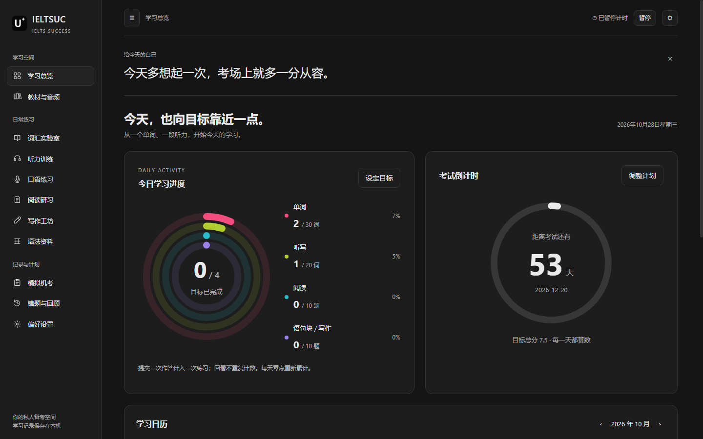

# IELTSUC · IELTS Success

<p align="center"></p>
<p align="center"><b>把每天的一点进步，积累成考场上的从容。</b></p>
<p align="center">Windows 桌面端 · 本地数据 · 中文回忆打字 · Ollama AI 教练</p>

[下载 Windows EXE](https://github.com/Lidazou/IELTSUC/releases) · [部署指南](docs/DEPLOYMENT.md) · [词库与导入](docs/VOCABULARY.md) · [本地模型](docs/OLLAMA.md)

IELTSUC 是个人雅思学习桌面应用。围绕听、说、读、写建立练习、反馈、记录与每日目标的循环。无需注册应用账号，词库、试卷、笔记和学习记录保存在本机。

> **公开版说明**：公开发行版提供 10 条入门示例，不附第三方教材 PDF、录音、完整题库或个人数据库。截图展示的是功能演示与个人资料集成场景，数据量不代表公开版默认附带内容。可导入自己有权使用的资料。

## 界面预览

### 每日目标与考试倒计时



设置单词、听写、阅读和语句块目标，用四层圆环显示每日进度。考试圆环内展示剩余天数和考试日期；日历记录学习时间与练习量，跨午夜分日保存。

### 中文提示 → 英文回忆



先看中文释义，独立输入英文。顶部展示准确率、WPM 和进度；提交以后再显示参考答案，支持上一词、下一词、跳过、错词重练和答对后自动前进。



### 黑白双主题



支持 16:10 笔记本、超宽屏以及较窄窗口。黑底白色 U＋图标，简洁的卡片与统一导航。

## 功能一览

| 模块 | 可以做什么 |
| --- | --- |
| 学习总览 | 考试日期、目标总分、每日目标圆环、日历、最近模考记录、开屏鼓励语 |
| 词汇实验室 | 添加新词、按词书筛选、中文回忆打字、文件导入、本地中英文 OCR |
| 听力训练 | 单词发音、键盘听写、正误反馈、自己的音频文件播放 |
| 阅读研习 | 阅读笔记、同义替换资料、导入词书后按顺序练习 |
| 写作工坊 | 中文语句块回忆、Task 1 / Task 2、字数统计、本地 AI 逐句建议 |
| 口语练习 | 话题练习与录音回顾；不包含自动语音识别或官方口语评分 |
| 模拟机考 | 导入自己的 PDF / DOCX，使用本地 AI 解析试卷、倒计时、交卷与答题复盘 |
| 数据管理 | SQLite 本地保存、导出备份、恢复备份、错题与笔记回顾 |

AI 反馈和模考分数都是练习辅助，不是官方 IELTS 成绩。导入试卷没有答案时不会凭空补全标准答案。

## 三分钟开始

1. 在 [Releases](https://github.com/Lidazou/IELTSUC/releases) 下载 `IELTSUC-1.3.1-win-x64.exe`。
2. 在 Windows x64 上启动，设置考试日期和每日目标。
3. 在“词汇实验室”导入 [示例 TSV](examples/vocabulary.tsv)，或添加自己的单词。
4. 开始中文回忆练习或听音听写。需要 AI 时再安装并配置 Ollama。

本项目以 Electron Windows 桌面应用运行，不是可直接上传 GitHub Pages 的网站。EXE 不包含 Ollama 和模型权重。

## 词库与教材

公开版自带 10 个示例词。个人版曾验证以下资料集成能力，详细解释见 [词库文档](docs/VOCABULARY.md)：

| 资料 | 个人版整理数量 | 排序 / 用途 | 公开版附带 |
| --- | ---: | --- | --- |
| 词汇真经 | 3744 条，22 章节 | 词汇与章节资料 | 否 |
| 听力 179 | 179 条 | 听写与同义替换 | 否 |
| 阅读 538 | 376 条主词条 | 按用户 PDF 顺序，含同义替换 | 否 |
| 训练营全 | 1488 条去重词 / 短语 | 听力听写 | 否 |
| 念念有词自测表 | 307 条去重表达 | 中文回忆、参考表达核对 | 否 |
| 写作念念有词 | 389 条核心表达 | 写作词汇、语句块记忆 | 否 |
| 原项目 100 句 | 100 句 | 翻译训练参考 | 否 |

“538”是资料栏目名称，不等于 538 行独立主词条。自测表原件只有中文提示，个人版结合写作教材补充参考表达；核心表达整理不等于整本书逐页例句转录。没有内置完整官方听说读写真题库。

可导入 TXT、CSV、TSV、DOCX、带文字层的 PDF，以及 PNG / JPG 等图片。扫描 PDF 请先导出图片使用 OCR。OCR 在本地运行，导入前请校对短语空格、词性和译文。

## 本地 AI 教练

安装 [Ollama](https://ollama.com/download)，下载一个本机能运行的文本对话模型。在“偏好设置”填写：

```text
服务地址：http://127.0.0.1:11434
模型名称：与 ollama list 输出完全一致的模型标签
```

点击“检测已安装模型”和“测试连接”。支持句子点评、作文建议、AI 出题与试卷解析。模型越大不一定越适合自己的电脑，先以短句验证连接和速度。不要把界面预填的模型名理解为软件已经替你安装了模型。

详细命令、硬件考虑、接口和排错见 [Ollama 部署指南](docs/OLLAMA.md)。

## 开发与构建

需要 Windows x64、Node.js 22 或更新的受支持版本、npm。

```powershell
git clone https://github.com/Lidazou/IELTSUC.git
cd IELTSUC
npm ci
npm test
npm start
npm run portable
```

构建结果在 `dist/`。`npm run dist` 生成目录版，`npm run portable` 生成单文件便携版。不要只复制目录版中的 EXE，它还依赖旁边的资源文件。

技术栈：Electron、原生 JavaScript / CSS、sql.js、Tesseract.js、Mammoth、pdf-parse，AI 经本机 Ollama `/api/chat` 调用。

## 数据与联网范围

学习数据默认写入 Electron 的用户数据目录（Windows 通常为 `%APPDATA%\ieltsuc`）。以应用内备份功能为准；便携 EXE 的“便携”指启动方式，不代表数据库一定保存在 EXE 旁边。

OCR 本地执行，AI 提示与作答发送至所配置的本机 Ollama。发音优先读取本地音频；无本地音频时访问有道英音接口并缓存，失败时使用 Windows 英语语音。因此“本地应用”不代表全部功能永不联网。

仓库不包含个人数据库、录音、私人教材、密钥或模型权重。发现问题请在 Issue 中提供复现步骤，注意遮盖自己的资料和学习内容。

## 特别鸣谢与技术参考

- **[hefengxian/my-ielts](https://github.com/hefengxian/my-ielts)**：感谢作者整理并分享雅思词汇、听力、阅读同义替换、语法和翻译训练的学习路径。IELTSUC 的教材组织方式、词汇与听写场景，以及英音播放方式参考了该项目。上游学习内容有其使用范围要求，链接或鸣谢不代表获得教材、音频再分发授权。
- **[Pandlagon/IELTS-Studio](https://github.com/Pandlagon/IELTS-Studio)**：感谢其 PDF / Word 试卷转交互机考、写作反馈和单词管理的产品思路，为 IELTSUC 模考流程提供功能参考。本项目使用自己的 Electron 与本地 Ollama 实现，不声称为其官方客户端或官方分支。
- [joeseesun/qiaomu-design](https://github.com/joeseesun/qiaomu-design)：中文排版、克制的视觉层级和响应式设计参考。
- [wave2234/liquid-glass-recipes](https://github.com/wave2234/liquid-glass-recipes)、[chthollyphile/folia-major](https://github.com/chthollyphile/folia-major)：早期界面探索参考；当前主界面采用黑白中性色设计。
- Electron、sql.js、Tesseract.js、Mammoth、pdf-parse、Ollama 及各自贡献者。

项目非 IELTS 官方产品，与上述项目及教材权利人不存在官方合作关系。第三方依赖与资料各自遵循原许可，详见 [第三方说明](THIRD_PARTY_NOTICES.md)。

维护者还可在 Actions 中手动运行 Windows release 工作流重新构建；不会在普通源码推送时重复覆盖 Release。
